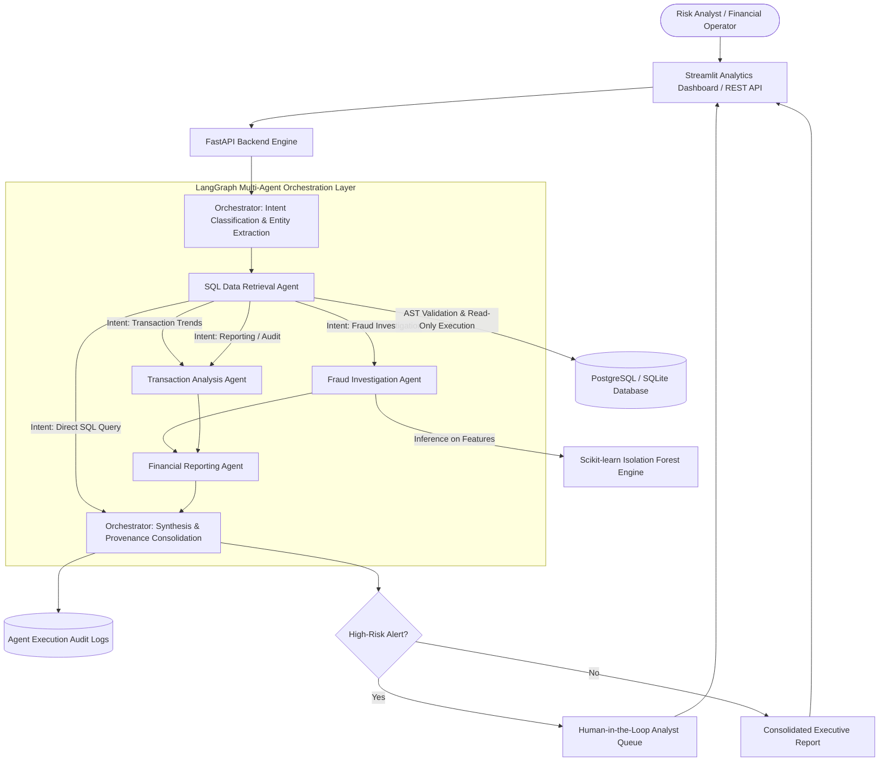

# 💳 Agentic AI Financial Operations Assistant

[](https://github.com/harsharaju1314-hash/Agentic-AI-Financial-Operations-Assistant/actions)
[](https://www.python.org/)
[](https://fastapi.tiangolo.com)
[](https://langchain-ai.github.io/langgraph/)
[](https://scikit-learn.org/)
[](https://streamlit.io/)
[](https://www.docker.com/)
[-brightgreen.svg)](tests/)

An enterprise-grade, multi-agent AI financial operations and risk management platform. Built with **Python 3.11+**, **LangGraph**, **Scikit-learn**, **FastAPI**, **PostgreSQL**, and **Streamlit**, this system automates transaction anomaly detection, fraud investigations, payment discrepancy analysis, natural language SQL retrieval, and executive financial reporting.

---

## 📑 Table of Contents
1. [Platform Architecture & Multi-Agent Workflow](#1-platform-architecture--multi-agent-workflow)
2. [Specialized AI Agents & State Management](#2-specialized-ai-agents--state-management)
3. [AI/ML Fraud Detection Engine & Evaluation](#3-aiml-fraud-detection-engine--evaluation)
4. [Relational Database Schema & SQL Security](#4-relational-database-schema--sql-security)
5. [REST API Documentation & Endpoints](#5-rest-api-documentation--endpoints)
6. [Interactive Streamlit Analytics Dashboard](#6-interactive-streamlit-analytics-dashboard)
7. [Automated Testing Suite (82% Coverage)](#7-automated-testing-suite-82-coverage)
8. [Docker & AWS Deployment Instructions](#8-docker--aws-deployment-instructions)
9. [Technical Interview Defense Guide](#9-technical-interview-defense-guide)

---

## 1. Platform Architecture & Multi-Agent Workflow

The system employs an intelligent multi-agent orchestration layer built with **LangGraph `StateGraph`**. Incoming natural language queries are parsed, contextualized with financial entities, dynamically routed through specialized agents, executed against a verified database, scored by an unsupervised machine learning engine, and synthesized into executive responses.



---

## 2. Specialized AI Agents & State Management

The orchestration runtime maintains an immutable, type-safe execution state:

```python
class FinancialAgentState(TypedDict):
    session_id: str
    user_query: str
    intent: str
    routed_agents: List[str]
    current_agent: str
    extracted_entities: Dict[str, Any]
    sql_query: Optional[str]
    sql_results: Optional[List[Dict[str, Any]]]
    sql_error: Optional[str]
    fraud_findings: Optional[Dict[str, Any]]
    analysis_summary: Optional[Dict[str, Any]]
    report_output: Optional[Dict[str, Any]]
    agent_logs: List[Dict[str, Any]]
    final_response: Optional[str]
    supporting_transactions: List[str]
    human_approval_required: bool
    recommended_action: Optional[str]
```

### Specialized Agents:
1. **Transaction Analysis Agent (`agents/transaction_analysis_agent.py`)**:
   - Computes historical spending baselines, standard deviations, and spending distribution.
   - Evaluates customer velocity and ticket spikes against historical averages.
2. **Fraud Investigation Agent (`agents/fraud_investigation_agent.py`)**:
   - Integrates Scikit-learn's `IsolationForest` for multivariate anomaly scoring.
   - Categorizes risk into `LOW`, `MEDIUM`, and `HIGH` tiers.
   - Generates human-readable explanatory factors (e.g. nocturnal hour, high-risk merchant category, amount surge).
3. **SQL Data Retrieval Agent (`agents/sql_retrieval_agent.py`)**:
   - Translates natural language inquiries into syntactically valid SQL queries.
   - Performs strict AST and regex validation to enforce read-only execution.
   - Restricts queries to approved financial tables and injects safe `LIMIT` constraints.
4. **Financial Reporting Agent (`agents/financial_reporting_agent.py`)**:
   - Synthesizes findings from database rows, analytics metrics, and anomaly scores.
   - Produces structured reports with Executive Summaries, Key Findings, and Actionable Containment Steps.
5. **Orchestrator Agent (`agents/orchestrator.py`)**:
   - Routes requests dynamically via LangGraph conditional edges.
   - Cross-references supporting transaction IDs (`TXN-...`).
   - Imposes Human-in-the-Loop (HITL) checkpoints before executing sensitive operations (e.g. account freezing).

---

## 3. AI/ML Fraud Detection Engine & Evaluation

The platform features an unsupervised anomaly detection pipeline utilizing Scikit-learn's `IsolationForest` algorithm combined with behavioral feature engineering.

### Feature Engineering Pipeline (`ml/features.py`):
- `amount`: Raw monetary value.
- `log_amount`: Log-transformed value for variance stabilization.
- `amount_to_avg_ratio`: Ratio of current transaction amount to customer's historical average spend.
- `amount_deviation`: Absolute monetary deviation from customer baseline.
- `hour_of_day` & `is_night_txn`: Time-of-day features highlighting transactions between 00:00 and 05:00 AM.
- `day_of_week`: Day of week indexing.
- `category_risk`: Numerical risk weight based on merchant category (Crypto Exchange: 0.85, Wire Transfer: 0.75, Retail: 0.10, Groceries: 0.04).
- `payment_method_risk`: Irreversibility risk weight (Crypto: 0.85, Wire: 0.70, Credit Card: 0.15).

### Empirical Evaluation on Held-Out Test Set (20% Split):
The model was trained on 9,600 synthetic transactions and rigorously evaluated on a held-out test set of 2,400 transactions:

| Metric | Score | Explanation |
| :--- | :--- | :--- |
| **Precision** | **74.29%** | 78 of 105 flagged alerts were confirmed true fraud attacks |
| **Recall** | **88.64%** | Successfully identified 78 out of 88 true fraudulent transactions |
| **F1 Score** | **0.8083** | Harmonic balance between detection accuracy and alert fatigue |
| **True Negatives (TN)** | **2,285** | Correctly cleared legitimate transactions |
| **False Positives (FP)** | **27** | Minimal operational overhead from false alerts |
| **False Negatives (FN)** | **10** | Missed marginal anomalies |
| **True Positives (TP)** | **78** | Intercepted high-severity fraudulent attacks |

---

## 4. Relational Database Schema & SQL Security

### Database Tables:
- `customers`: Account information, spending baselines, home jurisdiction, and status (`ACTIVE`, `FROZEN`, `UNDER_REVIEW`).
- `merchants`: Merchant classification, category risk index, location.
- `transactions`: Core transaction ledger with anomaly scores, risk tiers, and flagged reasons.
- `fraud_alerts`: Operational alert queue for risk analyst review (`PENDING_REVIEW`, `APPROVED_ACTION`, `DISMISSED`).
- `investigation_results`: Structured investigation dossiers and recommended actions.
- `agent_execution_logs`: Immutable audit trails logging every agent step, execution latency, and generated SQL.

### SQL Security & Read-Only Guardrails (`database/sql_validator.py`):
To prevent SQL injection and unauthorized schema mutations from AI-generated queries:
1. **Command Allowlist**: Only `SELECT` and `WITH ... SELECT` queries are permitted.
2. **Forbidden Keyword Blocking**: Hard AST/regex blocking for `DROP`, `DELETE`, `INSERT`, `UPDATE`, `ALTER`, `TRUNCATE`, `EXEC`, `CREATE`, `GRANT`, `REVOKE`.
3. **Multi-Statement Blocking**: Disallows semicolon-chained queries (e.g. `SELECT 1; DROP TABLE customers;`).
4. **Metadata Isolation**: Prohibits access to system catalogs (`information_schema`, `sqlite_master`, `pg_*`).
5. **Memory Protection**: Automatically appends `LIMIT 500` if no limit is specified.

---

## 5. REST API Documentation & Endpoints

The FastAPI backend provides interactive OpenAPI/Swagger documentation at `http://localhost:8000/docs`.

### Core Endpoints:

| Method | Endpoint | Description |
| :--- | :--- | :--- |
| `GET` | `/health` | Container and load-balancer health check |
| `POST` | `/transactions` | Ingest single transaction with real-time ML anomaly scoring |
| `POST` | `/transactions/batch` | Bulk ingest transactions with batch ML scoring |
| `GET` | `/transactions` | Filter transactions by customer, merchant, risk level, or date |
| `GET` | `/transactions/{id}` | Retrieve specific transaction details and scoring rationale |
| `GET` | `/transactions/customer/{id}` | Customer spending profile, aggregates, and history |
| `POST` | `/fraud/analyze` | On-demand anomaly evaluation for arbitrary transaction payloads |
| `GET` | `/fraud/alerts` | Retrieve pending and resolved fraud alerts |
| `POST` | `/fraud/alerts/{id}/action` | Human analyst approval (Freeze Account, Reverse Transaction, Dismiss) |
| `GET` | `/analytics/summary` | Top-level operational KPIs (total volume, value, flagged ratio) |
| `GET` | `/analytics/merchants/top` | Top merchants ranked by transaction volume |
| `POST` | `/agents/query` | Natural language inquiry dispatched to the LangGraph Multi-Agent Swarm |
| `GET` | `/agents/executions` | Immutable audit trail of agent executions and SQL statements |
| `GET` | `/reports/financial` | Executive customer or merchant financial risk assessment report |

---

## 6. Interactive Streamlit Analytics Dashboard

Launch the web dashboard via:
```bash
streamlit run dashboard/app.py
```

### Dashboard Capabilities:
1. **Executive Overview**: Total transaction count, dollar volume, high-risk ratios, and pending alert counters.
2. **Interactive Visualizations**:
   - Daily and monthly volume trends (Plotly line charts).
   - Category spending distributions (donut chart).
   - Isolation Forest anomaly score histogram with color-coded risk bands.
   - Top merchant leaderboard.
3. **Multi-Agent AI Operations Console**:
   - Interactive prompt interface to query the LangGraph multi-agent team.
   - Visual execution flow displaying which specialized agents processed each request.
   - Collapsible telemetry section detailing generated SQL and agent execution logs.
4. **Human-in-the-Loop Fraud Approval Queue**:
   - Review pending high-risk alerts with anomaly scores and explanatory factors.
   - One-click buttons to **Freeze Account**, **Reverse Charge**, or **Dismiss Alert (False Positive)**.
5. **Drilldown Analytics**: Deep dive into customer spending baselines or merchant volume profiles.
6. **On-Demand ML Simulator**: Test arbitrary transaction parameters against the trained Isolation Forest model in real time.

---

## 7. Automated Testing Suite (82% Coverage)

The test suite consists of **45 comprehensive unit and integration tests** built with **Pytest**:

```bash
pytest --cov=. --cov-report=term-missing tests/
```

### Measured Test Coverage Breakdown:
```text
Name                                   Stmts   Miss  Cover   Missing
--------------------------------------------------------------------
agents\financial_reporting_agent.py       50      1    98%   33
agents\fraud_investigation_agent.py       60      6    90%   62-71
agents\llm_factory.py                     65     21    68%   
agents\orchestrator.py                   143     24    83%   
agents\sql_retrieval_agent.py             48     10    79%   
agents\state.py                           19      0   100%
agents\transaction_analysis_agent.py      44      0   100%
api\main.py                               34      4    88%   
api\routers\agents.py                     26      7    73%   
api\routers\analytics.py                  21      2    90%   
api\routers\fraud.py                      50      7    86%   
api\routers\reports.py                    31      1    97%   
api\routers\transactions.py               79      7    91%   
api\schemas.py                           110      0   100%
database\models.py                        85      0   100%
database\queries.py                       37      1    97%   
database\sql_validator.py                 40      3    92%   
ml\features.py                            35      3    91%   
ml\fraud_detector.py                     104     25    76%   
--------------------------------------------------------------------
TOTAL                                   1483    265    82%
============================= 45 passed in 4.5s ==============================
```

---

## 8. Docker & AWS Deployment Instructions

### Local Docker Compose:
To spin up the entire multi-service stack (FastAPI, Streamlit, PostgreSQL 16, Persistent Volumes):

```bash
# 1. Copy environment template
cp .env.example .env

# 2. Build and launch containers
docker-compose up -d --build

# 3. Access endpoints
# - FastAPI API & Swagger: http://localhost:8000/docs
# - Streamlit Dashboard:   http://localhost:8501
```

### AWS EC2 Automated Deployment:
The repository includes a production deployment script (`deploy/deploy_ec2.sh`), systemd service unit (`deploy/financial_ops.service`), and Nginx reverse proxy configuration (`deploy/nginx.conf`):

```bash
# On an Ubuntu 22.04 / 24.04 LTS EC2 Instance:
curl -fsSL https://raw.githubusercontent.com/harsharaju1314-hash/Agentic-AI-Financial-Operations-Assistant/main/deploy/deploy_ec2.sh | bash
```

### AWS S3 Cloud Storage Integration:
Datasets, model weights, and financial reports can be archived to AWS S3 using `cloud/s3_storage.py`. Configure credentials in `.env`:
```env
AWS_ACCESS_KEY_ID=your_access_key
AWS_SECRET_ACCESS_KEY=your_secret_key
AWS_DEFAULT_REGION=us-east-1
S3_BUCKET_NAME=finops-transactions-archive
```

---

## 9. Technical Interview Defense Guide

### Q1: Why LangGraph instead of linear chains or autonomous loops?
> **Answer:** In high-stakes financial operations, non-deterministic autonomous loops can suffer from runaway execution, state corruption, and hallucinated calculations. LangGraph provides a cyclical `StateGraph` where every state transition is explicitly defined, type-checked, and logged. Each node specializes in a single responsibility (SQL extraction, feature scoring, trend analysis, or reporting), and conditional edges enforce deterministic routing paths based on parsed intent.

### Q2: Why Isolation Forest for fraud detection instead of Supervised Learning?
> **Answer:** In operational financial environments, fraud patterns are constantly evolving (zero-day fraud typologies, new laundering rails, novel velocity attacks). Supervised models overfit to historical labeled fraud and fail on emerging patterns. Isolation Forest isolates anomalies by randomly partitioning feature space; anomalous points require fewer splits to isolate, making it robust at flagging previously unseen high-risk transactions without requiring labeled historical bias.

### Q3: How is SQL injection prevented when AI models generate SQL?
> **Answer:** The system implements a defense-in-depth model. Natural language inquiries are never passed directly to database execution. The query passes through `database/sql_validator.py`, which parses the abstract syntax tree (AST) using `sqlparse`. It verifies that the query is strictly a `SELECT` or `WITH ... SELECT` statement, enforces a hard block on all DDL/DML keywords (`DROP`, `DELETE`, `UPDATE`, `INSERT`), blocks multi-statement chaining, restricts table access to approved application schemas, and automatically injects a safe `LIMIT` clause.

### Q4: How is Human-in-the-Loop (HITL) implemented?
> **Answer:** Automated AI agents are restricted to read-only investigations. Any action with financial consequences (freezing customer accounts, reversing payments, or submitting regulatory SAR filings) triggers a `human_approval_required` flag in the agent state. The transaction is placed into the `fraud_alerts` queue with status `PENDING_REVIEW`. A licensed risk analyst must review the agent's findings and click "Approve" via the Streamlit review console or `/fraud/alerts/{id}/action` endpoint before state changes are committed to the ledger.

---

## 👥 Author
**Harshavardhan Varma**  
Email: [harsharaju1314@gmail.com](mailto:harsharaju1314@gmail.com)  
GitHub: [harsharaju1314-hash](https://github.com/harsharaju1314-hash)
